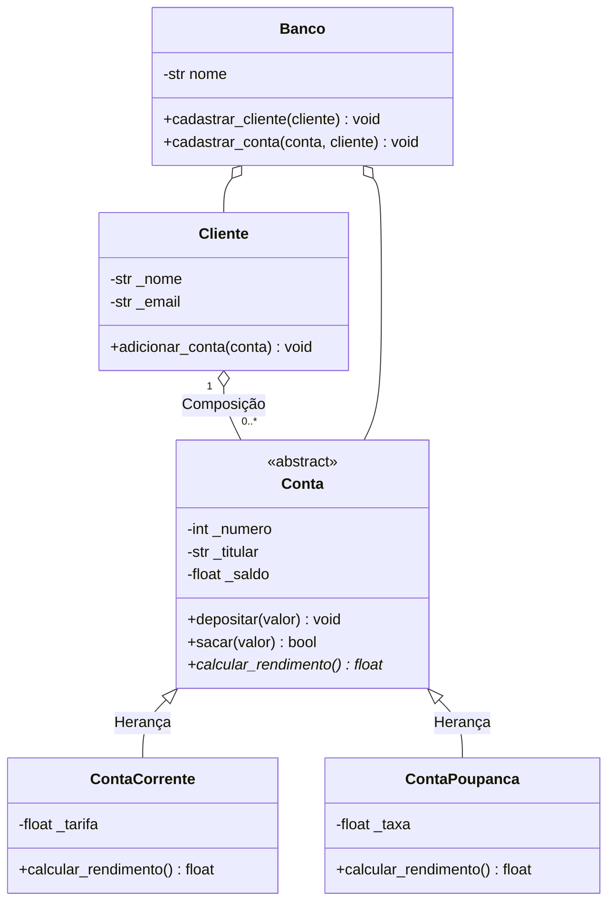

# Sistema Bancário com Programação Orientada a Objetos

## 💻 Sobre o projeto

Este projeto foi desenvolvido em Python para praticar os conceitos de **Programação Orientada a Objetos (POO)**.

O sistema permite cadastrar clientes e contas bancárias, realizar depósitos e saques, validar dados e calcular resultados diferentes conforme o tipo de conta cadastrada.

---

## 🛠️ Tecnologias utilizadas

* **Python 3**
* **Programação Orientada a Objetos (POO)**
* **Git e GitHub**

---

## 📊 Diagrama de classes



---

## 🧠 Conceitos aplicados

* **Abstração:** A classe `Conta` define um modelo geral e abstrato para os outros tipos de conta.
* **Encapsulamento:** Propriedades (`@property`) e métodos de acesso protegem os atributos internos contra modificações inválidas.
* **Herança:** As classes `ContaCorrente` e `ContaPoupanca` herdam os atributos e métodos base da classe mãe `Conta`.
* **Polimorfismo:** Cada tipo de conta implementa seu próprio cálculo de rendimento ou desconto de forma personalizada.
* **Composição:** Os clientes possuem contas associadas e gerenciadas dentro de sua estrutura.
* **Métodos especiais:** Uso dos dunder methods `__init__`, `__str__`, `__repr__` e `__eq__` para total integração com o ecossistema Python.

---

## 🛡️ Validações

O sistema possui regras estritas de negócios e impede as seguintes operações:
* Saldos negativos arbitrários.
* Depósitos e saques com valores inválidos (menores ou iguais a zero).
* Tarifas negativas em contas correntes.
* Taxas de rendimento fora do intervalo permitido para contas poupança.
* E-mails em formato inválido.

As propriedades atuam como barreiras de segurança, validando os dados antes de armazená-los nos objetos.

---

## 🚀 Como executar

1. Certifique-se de ter o **Python 3** instalado em sua máquina.
2. Faça o clone ou o download deste repositório.
3. Abra a pasta do projeto no terminal ou no VS Code.
4. Execute o seguinte comando:

```bash
python main.py
```

---

## 🧪 Testes e demonstração

O script de execução principal simula um ambiente de produção real onde:
* O programa cria **dez clientes** e **dez contas**.
* Demonstra o **polimorfismo** aplicando os rendimentos e tarifas em lote.
* Trata exceções em tempo de execução com blocos `try/except` para garantir que o sistema não caia ao receber dados inválidos.

---

## ✍️ Autoria

Projeto acadêmico desenvolvido de forma prática para consolidação dos conceitos de POO em Python.
