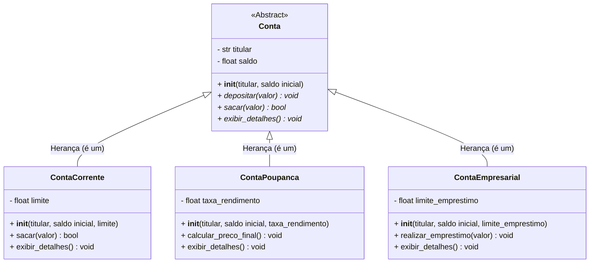

# Sistema de Gerenciamento OO em Python 🚀
### Entregável da Semana 06 - Desafio Sprint 6

Este projeto consiste na finalização de um **Sistema Completo Orientado a Objetos** desenvolvido em Python, aplicando de forma prática os conceitos de classes, objetos, encapsulamento, herança, polimorfismo, classes abstratas e métodos especiais (Dunder).

---

## 📊 Diagrama de Classes (Mermaid)

---

## 📋 Justificativas de Modelagem e Decisões Técnicas

### 1. Herança vs. Composição
Seguindo a regra de ouro e os princípios de design de software (GoF), a **Herança** foi utilizada estritamente onde a relação lógica é clara de **"é um"**:
* `ContaCorrente` **é uma** `Conta`.
* `ContaPoupanca` **é uma** `Conta`.

Essa abordagem permitiu o reaproveitamento de código e a definição de um contrato claro a partir de uma classe base. Componentes que não configuram uma especialização direta usam composição ou propriedades locais para evitar o acoplamento excessivo.

### 2. Classes Abstratas e Polimorfismo
A classe principal `Conta` foi definida como uma **Classe Abstrata** utilizando o módulo `abc` (`ABC` e `@abstractmethod`).
* **Polimorfismo:** Método sobrescrito nas classes filhas (ex: `exibir_detalhes()` ou métodos de transação específica), permitindo que objetos de classes diferentes respondam à mesma chamada de formas distintas e apropriadas para o seu contexto.

### 3. Encapsulamento com `@property`
Para proteger o estado interno dos objetos e garantir que nenhum dado inválido modifique os atributos diretamente, foi aplicado o encapsulamento com getters e setters via `@property`:
* **Validações Aplicadas:** Uso do `@property.setter` para impedir a atribuição de saldos negativos arbitrários, nomes de titulares vazios ou formatos numéricos incorretos. Isso garante a consistência do objeto desde a sua inicialização.

### 4. Construtor e Métodos Especiais (Dunder)
* **`__init__`:** Inicialização de atributos com valores padronizados de forma segura (usando `None` quando necessário, evitando mutabilidade indesejada em coleções).
* **`super().__init__()`:** Chamada explícita nas classes filhas para reaproveitar o código de inicialização da classe mãe.
* **`__str__` e `__repr__`:** Implementados em todas as classes para fornecer uma representação textual legível e amigável para o usuário e para o desenvolvedor durante a depuração.

---

## 🛠️ Padrões de Código Adotados

* **PascalCase:** Utilizado estritamente na nomeação de todas as Classes.
* **snake_case:** Utilizado para métodos, funções e variáveis.
* **PEP 8:** Adesão estrita às boas práticas de estilo do Python, incluindo o uso de *Docstrings* explicativas em todas as classes e métodos principais.

---

## 🧪 Testes e Demonstração
O script de execução principal instancia **pelo menos 10 objetos** distintos para preencher e validar o modelo de negócios do ecossistema. Ele realiza iterações polimórficas sobre coleções de objetos e implementa blocos `try/except` robustos para capturar e tratar entradas inválidas de forma elegante, sem interromper o fluxo do sistema.
